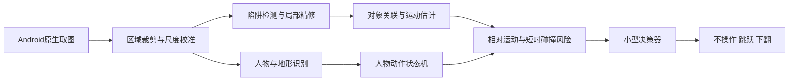

# 竞技场结构化视觉控制方案

状态：待用户确认。仅高速取图已实现；本文的识别、跟踪、决策和训练均未动手。

第一版把图像转为“人物状态、可行地形、陷阱及其运动”，让小型决策器处理这些结构化数据。板子编号和标准跑法不作为必需输入，也不让决策模型直接从整张画面自行学习全部视觉与运动关系。

## 前处理与识别

保留原1280×720像素，先在640×360上做全局识别；细飞镖、绳沿和尖刺等小目标再使用对应原尺寸局部区域精修。屏蔽固定HUD区域，统一颜色与坐标，只做一遍图像转换。初期使用一个共享骨干的轻量检测器，同时输出人物、陷阱类别及几何信息，避免每类陷阱各跑一个网络。

陷阱不能仅用外接矩形代表危险范围。静态尖刺/墙体输出危险轮廓；弹丸输出中心与半径；摆锤/旋转机关输出锚点、端点和角度；伸缩刺、激光等还要估计激活状态。地形另提取绳段、地面、断口、墙及上方障碍，建立角色附近的可行区域。板子衔接处的坑和墙属于连续地形，不在板子结束时清空。

完整客户端数据可在之后获准实施时提供类型、可见几何及动作状态标注，但推理侧只使用画面。视觉轮廓、真实碰撞范围和特效必须分别校验，不能把红色特效或飘带全部标成碰撞体。

## 陷阱关联与运动估计

连续帧先做同类对象关联，维持短期对象ID，再估计位置、速度及置信度。可借鉴ByteTrack的高低置信检测关联，避免一次低分就丢掉危险物；采用观察修正抑制遮挡期间预测误差累积。论文中的行人性能不作为游戏性能承诺。[ByteTrack](https://arxiv.org/abs/2110.06864)、[OC-SORT](https://arxiv.org/abs/2203.14360)。

运动模型按类型区分：弹丸采用短时速度/加速度；摆锤、旋转锯等估计角度、角速度及相位；伸缩类维护激活状态及状态变化趋势。不能把所有陷阱都当匀速直线物体。遮挡和突然出现时扩大不确定范围，等待新观察修正。

优先使用陷阱相对角色的运动。需要镜头补偿时，参考同一前景层的绳索、固定地面等，不能拿有视差的远景直接代表镜头速度；镜头缩放还需尺度更新。光流用于短帧跟踪，不能单凭运动像素判定“这是陷阱”。[BoT-SORT的镜头补偿](https://arxiv.org/abs/2206.14651)、[OpenCV光流](https://docs.opencv.org/4.x/d4/dee/tutorial_optical_flow.html)。

## 人物状态

给决策器的当前状态包括：身体位置/范围、相对速度、绳上/绳下、接地/腾空、一段跳/二段跳及升降阶段、剩余跳跃次数、下翻过渡、受击/死亡和估计置信度。

由人物局部识别、相对绳线的位置、短时纵向运动和已发出操作维护一个有限状态机。落地重置跳跃计数，升降变化修正状态；不是只按按钮次数盲记。单张图不一定能区分一段跳与二段跳，因此保留这个小状态机即可，不把长操作序列交给决策模型。陷阱跟踪仍需要短期观测历史来计算运动。

## 决策输入与输出

输入由三部分组成：人物状态向量、附近地形、按危险程度筛选的一组陷阱对象。每个陷阱包含类型、相对位置、危险几何、相对速度、角运动/激活状态、预计接触时间、观察年龄和不确定度。

先用原动作参数建立短时候选预测，对不操作、跳跃、下翻分别估计人物路径与陷阱扫过区域的相交风险。它只预测当前附近几百毫秒至一次跳跃的范围，不做完整地图穷举或客户端回档。动态机关预测不能保证精确，必须把误差范围纳入风险。

后续决策模型只处理这些小向量及对象集合，可使用小MLP和对象汇聚结构。模型大小与速度需要实测；结构化输入让视觉问题和控制问题分开验收，不能据此直接承诺某个推理耗时。首版不需要大图像循环策略，也不依赖标准板子跑法。

## 之后的训练与验收

获准后先完成感知识别和状态估计回放，检查细小危险物漏检、几何边界、运动预测误差及一二段跳/绳上绳下混淆。然后建立可解释的短时决策基线，再训练小型策略并比较收益。原客户端可提供训练奖励和标注，无需先获得高手操作录像；但不能将训练标注中的内部坐标直接泄漏到部署输入。

随机陷阱通过实测位置和运动处理；板间衔接通过连续地形和人物状态处理。测试按不同版型、随机种子、连接处和突发陷阱分组，不只看固定板回放。5000血和Boss1血属于当前调试条件，后续验收应明确实际目标难度。

## 时间预算与实施边界

高速取图使用Android原生显示捕获及本命名设备的常驻数据通道，不连接桌面Wayland截图协议，也不调用宿主合成器。当前原尺寸动态画面120次请求中位数约10.3ms、P95约12.1ms；这是请求到宿主整帧像素的时间，不是已经测出的完整感知决策输入延迟。初次长测的约90ms冷捕获已移到启动预热；预热后640×360再测1500帧最大8.4ms，仍不作硬实时保证。

下一步方案验收还需分别测前处理、检测、跟踪、决策与原按钮真正生效的时间。感知可按帧预算分配检测频率，并在中间帧做轻量跟踪；新出现危险物必须触发更新，不能只盯屏幕右边或始终使用旧检测。所有模块保留帧号和时间戳，按最新状态外推短时风险。

本次仅交付高速取图代码和上述方案。训练相关代码、检测模型、跟踪器、数据集标注及自动操作均等待用户确认后再做。
